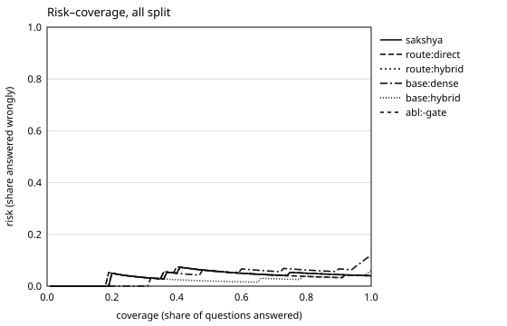

# Known-item sanity check

> SANITY CHECK, NOT SAKSHYA-BENCH: 100 automatic known-item queries (copied from the page, seed 11). A copied sentence must retrieve its own page. These are not questions a person asked and favour lexical matching; they only show that the harness, indexes and routes work end to end.

- **Split:** all · **scope:** document (67 documents in the collection)
- **Questions:** 100 (100 answerable, 0 unanswerable)
- **Command:** `python -m eval known-item --n 100 --systems sakshya,route:direct,route:hybrid,base:dense,base:hybrid,abl:-reranker,abl:-ocr-aware,abl:-digits,abl:-gate`
- **Commit:** 7dd17c2+uncommitted · **date:** 2026-10-03T18:07:36+00:00 · **machine:** Windows-10-10.0.26200-SP0 (12 CPUs)
- **Config:** top-k 40, top-n 6, tau 0.15, RRF weights {'dense': 1.0, 'word': 1.0, 'char': 0.6, 'exact': 0.8, 'translate': 1.0}
- **Peak RAM of the evaluation process:** 5049.9 MB · run time 622.0 s

## RQ1: retrieval by route (answerable questions, page level)

| System | Recall@5 | Recall@20 | MRR@10 | nDCG@10 |
| --- | --- | --- | --- | --- |
| Direct route, full stack | 0.950 [0.900, 0.990] | 0.970 [0.930, 1.000] | 0.927 [0.878, 0.972] | 0.933 [0.887, 0.976] |
| Hybrid route, full stack | 0.960 [0.920, 0.990] | 0.970 [0.930, 1.000] | 0.937 [0.889, 0.975] | 0.943 [0.897, 0.980] |
| Sakshya (router, all components) | 0.960 [0.920, 0.990] | 0.970 [0.930, 1.000] | 0.937 [0.889, 0.975] | 0.943 [0.897, 0.980] |
| Oracle (best route per question; upper bound for routing) | 0.960 [0.920, 0.990] | 0.980 [0.950, 1.000] | 0.937 [0.889, 0.975] | 0.943 [0.897, 0.980] |

Mean with a 95% bootstrap interval. _all split · n = 100 · `python -m eval known-item --n 100 --systems sakshya,route:direct,route:hybrid,base:dense,base:hybrid,abl:-reranker,abl:-ocr-aware,abl:-digits,abl:-gate`_

Best fixed route on this split (by MRR@10): **route:hybrid**.

### By question language (Recall@20 / MRR@10)

| System | en (n=51) | hi (n=17) | mr (n=32) |
| --- | --- | --- | --- |
| Direct route, full stack | 0.96 / 0.95 | 1.00 / 0.89 | 0.97 / 0.91 |
| Hybrid route, full stack | 0.98 / 0.97 | 1.00 / 0.89 | 0.94 / 0.91 |
| Sakshya (router, all components) | 0.98 / 0.97 | 1.00 / 0.89 | 0.94 / 0.91 |

_all split · n = 100 · `python -m eval known-item --n 100 --systems sakshya,route:direct,route:hybrid,base:dense,base:hybrid,abl:-reranker,abl:-ocr-aware,abl:-digits,abl:-gate`_

### By document type (Recall@20 / MRR@10)

| System | native (n=41) | scanned (n=59) |
| --- | --- | --- |
| Direct route, full stack | 0.98 / 0.98 | 0.97 / 0.89 |
| Hybrid route, full stack | 1.00 / 1.00 | 0.95 / 0.89 |
| Sakshya (router, all components) | 1.00 / 1.00 | 0.95 / 0.89 |

_all split · n = 100 · `python -m eval known-item --n 100 --systems sakshya,route:direct,route:hybrid,base:dense,base:hybrid,abl:-reranker,abl:-ocr-aware,abl:-digits,abl:-gate`_

### By slice (Recall@20 / MRR@10)

| System | known_item (n=100) |
| --- | --- |
| Direct route, full stack | 0.97 / 0.93 |
| Hybrid route, full stack | 0.97 / 0.94 |
| Sakshya (router, all components) | 0.97 / 0.94 |

_all split · n = 100 · `python -m eval known-item --n 100 --systems sakshya,route:direct,route:hybrid,base:dense,base:hybrid,abl:-reranker,abl:-ocr-aware,abl:-digits,abl:-gate`_

### By question type (Recall@20 / MRR@10)

| System | date (n=3) | list (n=1) | other (n=87) | person (n=4) | procedure (n=2) | reason (n=3) |
| --- | --- | --- | --- | --- | --- | --- |
| Direct route, full stack | 1.00 / 0.73 | 1.00 / 1.00 | 0.97 / 0.95 | 1.00 / 1.00 | 1.00 / 1.00 | 1.00 / 0.33 |
| Hybrid route, full stack | 1.00 / 0.73 | 1.00 / 1.00 | 0.98 / 0.96 | 1.00 / 1.00 | 1.00 / 1.00 | 0.67 / 0.33 |
| Sakshya (router, all components) | 1.00 / 0.73 | 1.00 / 1.00 | 0.98 / 0.96 | 1.00 / 1.00 | 1.00 / 1.00 | 0.67 / 0.33 |

_all split · n = 100 · `python -m eval known-item --n 100 --systems sakshya,route:direct,route:hybrid,base:dense,base:hybrid,abl:-reranker,abl:-ocr-aware,abl:-digits,abl:-gate`_

Routes the router chose: direct 36, hybrid 62, translate 2.

## Baselines (plan §9.2)

| System | Recall@20 | MRR@10 | Δ Recall@20 vs Sakshya | Δ MRR@10 vs Sakshya |
| --- | --- | --- | --- | --- |
| Vanilla dense: E5 only, no reranker, no gate | 0.950 [0.900, 0.990] | 0.787 [0.714, 0.854] | -0.020 [-0.050, +0.000] | -0.150 [-0.215, -0.094] **real** |
| Hybrid without reranking and without the gate | 0.980 [0.950, 1.000] | 0.893 [0.839, 0.945] | +0.010 [-0.020, +0.050] | -0.044 [-0.078, -0.010] **real** |

Δ is the paired bootstrap difference (1,000 resamples) with its 95% interval; **real** = the interval excludes zero. _all split · n = 100 · `python -m eval known-item --n 100 --systems sakshya,route:direct,route:hybrid,base:dense,base:hybrid,abl:-reranker,abl:-ocr-aware,abl:-digits,abl:-gate`_

## Ablations (plan §9.3)

| System | Recall@20 | MRR@10 | Δ Recall@20 vs Sakshya | Δ MRR@10 vs Sakshya |
| --- | --- | --- | --- | --- |
| No reranker (fused order; the gate still scores the top 6) | 0.980 [0.950, 1.000] | 0.883 [0.826, 0.937] | +0.010 [+0.000, +0.030] | -0.054 [-0.092, -0.018] **real** |
| No OCR-aware weighting | 0.970 [0.930, 1.000] | 0.937 [0.889, 0.975] | +0.000 [+0.000, +0.000] | +0.000 [+0.000, +0.000] |
| No digit normalization (question side) | 0.970 [0.930, 1.000] | 0.937 [0.889, 0.975] | +0.000 [+0.000, +0.000] | +0.000 [+0.000, +0.000] |
| No evidence gate | 0.970 [0.930, 1.000] | 0.937 [0.889, 0.975] | +0.000 [+0.000, +0.000] | +0.000 [+0.000, +0.000] |

Δ is the paired bootstrap difference (1,000 resamples) with its 95% interval; **real** = the interval excludes zero. _all split · n = 100 · `python -m eval known-item --n 100 --systems sakshya,route:direct,route:hybrid,base:dense,base:hybrid,abl:-reranker,abl:-ocr-aware,abl:-digits,abl:-gate`_

## Abstention and risk–coverage

Retrieval-level risk: answering counts as an error when the question is unanswerable or the gold page is not among the 6 passages sent to the answer model. Answer-level numbers need the answer model (`python -m eval answers`).

| System | Answered | Risk when answered | Abstention precision | Abstention recall | Wrongly abstained | AURC |
| --- | --- | --- | --- | --- | --- | --- |
| Sakshya (router, all components) | 1.00 | 0.04 | – | – | 0 | 0.039 |
| Direct route, full stack | 0.99 | 0.04 | 0.00 | – | 1 | 0.038 |
| Hybrid route, full stack | 1.00 | 0.04 | – | – | 0 | 0.039 |
| Vanilla dense: E5 only, no reranker, no gate | 1.00 | 0.12 | – | – | 0 | 0.041 |
| Hybrid without reranking and without the gate | 1.00 | 0.06 | – | – | 0 | 0.025 |
| No reranker (fused order; the gate still scores the top 6) | 0.99 | 0.05 | 0.00 | – | 1 | 0.026 |
| No OCR-aware weighting | 1.00 | 0.04 | – | – | 0 | 0.039 |
| No digit normalization (question side) | 1.00 | 0.04 | – | – | 0 | 0.039 |
| No evidence gate | 1.00 | 0.04 | – | – | 0 | 0.039 |

_all split · n = 100 · `python -m eval known-item --n 100 --systems sakshya,route:direct,route:hybrid,base:dense,base:hybrid,abl:-reranker,abl:-ocr-aware,abl:-digits,abl:-gate`_

## Latency per stage (sakshya, ms)

| Stage | p50 | p95 | n |
| --- | --- | --- | --- |
| dense | 10 | 53 | 100 |
| dense_en | 4 | 7 | 100 |
| embed | 111 | 200 | 100 |
| langid | 0 | 6 | 100 |
| lexical | 9 | 19 | 100 |
| probe | 344 | 594 | 100 |
| rerank | 2759 | 3635 | 100 |
| retrieval_total | 3301 | 4252 | 100 |
| translate | 1960 | 4232 | 47 |
| transliterate | 2912 | 2912 | 1 |

Measured on the first system run for each question, before any cache for it was warm. _all split · n = 100 · `python -m eval known-item --n 100 --systems sakshya,route:direct,route:hybrid,base:dense,base:hybrid,abl:-reranker,abl:-ocr-aware,abl:-digits,abl:-gate`_
